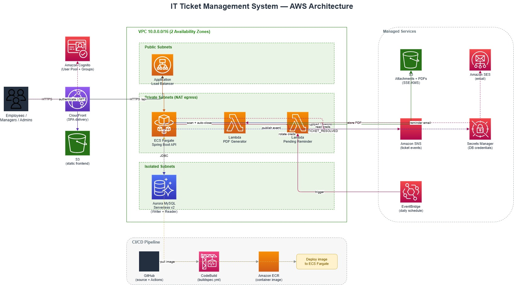

# IT Ticket Management System

A production-style IT ticket management platform built with **Spring Boot 3** and **AWS**.
Employees raise tickets, managers approve them, agents resolve them, and the system
handles file attachments, email notifications, event publishing, and PDF resolution
reports. Infrastructure is defined as code with the **AWS CDK (Java)**.

The app runs **locally with zero AWS setup** (in-memory H2 + seeded demo data) and
deploys to AWS using containers on **ECS Fargate** behind an **ALB**, with
**Aurora MySQL Serverless v2**, **Cognito**, **S3**, **SES**, **SNS**, and **Lambda**.

## Architecture



> The diagram is an editable draw.io file at [`docs/architecture.drawio`](docs/architecture.drawio).
> Open it at [app.diagrams.net](https://app.diagrams.net) or with the draw.io VS Code extension.

**Request flow:** Client → CloudFront (SPA) → ALB → ECS Fargate (Spring Boot API) → Aurora MySQL.
**Async flow:** API publishes events to SNS → PDF Generator Lambda writes a resolution PDF to S3.
A scheduled Reminder Lambda scans Aurora for stale tickets, sends reminders via SES, and auto-closes.

## Tech stack

| Layer           | Technology                                                        |
|-----------------|-------------------------------------------------------------------|
| Backend         | Java 21, Spring Boot 3.3 (Web, Data JPA, Security, Validation)    |
| Auth            | Spring Security OAuth2 Resource Server + Amazon Cognito (JWT)     |
| Database        | Aurora MySQL Serverless v2 (prod), H2 (local), Flyway migrations  |
| Storage         | Amazon S3 (attachments + generated PDFs, SSE-KMS, presigned URLs) |
| Notifications   | Amazon SES (email), Amazon SNS (events)                           |
| Serverless      | AWS Lambda (PDF generation via iText, pending-ticket reminders)   |
| Infrastructure  | AWS CDK (Java) — VPC, Aurora, Cognito, S3                         |
| Delivery        | Docker, Amazon ECR, CodeBuild (`buildspec.yml`), GitHub Actions   |
| Frontend        | Vanilla HTML/CSS/JS single-page app (no build step)              |

## Project layout

```
ticket-mgmt-aws/
├── src/main/java/com/ticketmgmt/
│   ├── config/        # AWS + security + CORS + local seeder
│   ├── controller/    # REST: tickets, employees, dashboard
│   ├── dto/           # request/response DTOs
│   ├── exception/     # global handler + ApiError
│   ├── lambda/        # PDF generator + pending reminder handlers
│   ├── model/         # JPA entities + enums
│   ├── repository/    # Spring Data repositories
│   └── service/       # business logic + AWS/local adapters
│       ├── aws/       # S3, SES, SNS implementations (profile: aws)
│       └── local/     # disk + logging implementations (profile: local)
├── src/main/resources/
│   ├── application.yml        # local + docker profiles
│   ├── application-aws.yml    # aws profile
│   └── db/migration/          # Flyway schema (V1__init_schema.sql)
├── cdk/               # AWS CDK app: Vpc, Database, Cognito, Storage,
│                      #   Messaging (SNS + Lambdas), Ecs (Fargate + ALB)
├── frontend/          # static SPA (index.html, css/, js/)
├── docs/              # architecture.drawio
├── DEPLOYMENT.md      # step-by-step AWS deploy guide
├── scripts/deploy.sh  # one-command AWS deploy
├── Dockerfile         # multi-stage build on Amazon Corretto 21
├── docker-compose.yml # local app + MySQL
├── buildspec.yml      # CodeBuild → ECR
└── .github/workflows/ # CI (build, verify, docker smoke)
```

## Run locally (no AWS, no Docker)

Requires Java 21+. The Maven Wrapper (`./mvnw`) downloads Maven automatically.

```bash
./mvnw spring-boot:run
# or: ./mvnw clean package && java -jar target/TicketGatewayService-1.0.0.jar
```

The app starts on <http://localhost:8080/api> using the `local` profile:
an in-memory H2 database seeded with 3 employees and 3 tickets. Security is open
locally and the H2 console is at `/api/h2-console`.

### Open the UI

Serve the `frontend/` folder with any static server and open it in a browser:

```bash
cd frontend && python3 -m http.server 5500
# then open http://localhost:5500
```

The SPA calls `http://localhost:8080/api` by default. Point it elsewhere with a
query param, e.g. `http://localhost:5500/?api=https://your-host/api`.

## Run with Docker Compose (MySQL)

```bash
docker compose up --build
```

Starts MySQL 8 and the app with the `docker` profile on <http://localhost:8080/api>.

## REST API

Base path: `/api` (context path). Common endpoints:

| Method | Path                               | Description                        |
|--------|------------------------------------|------------------------------------|
| GET    | `/actuator/health`                 | Health check                       |
| GET    | `/dashboard/stats`                 | Totals and counts by status        |
| GET    | `/tickets?status=&page=&size=`     | List tickets (paged)               |
| POST   | `/tickets`                         | Create a ticket                    |
| GET    | `/tickets/{id}`                    | Get a ticket                       |
| PATCH  | `/tickets/{id}/status`             | Change status                      |
| POST   | `/tickets/resolve/{id}`            | Resolve a ticket                   |
| POST   | `/tickets/{id}/attachments`        | Upload an attachment (multipart)   |
| GET    | `/tickets/{id}/attachments/url`    | Presigned download URL             |
| GET    | `/tickets/{id}/history`            | Ticket audit history               |
| GET    | `/employees`                       | List employees                     |

Example:

```bash
curl -X POST http://localhost:8080/api/tickets \
  -H "Content-Type: application/json" \
  -d '{"title":"VPN down","priority":"HIGH","category":"Network","createdById":2}'
```

### Ticket lifecycle

```
OPEN → PENDING_APPROVAL → APPROVED/REJECTED → IN_PROGRESS → RESOLVED → CLOSED
                                                          ↘ REOPENED
stale tickets → AUTO_CLOSED (by reminder Lambda)
```

## Profiles

| Profile  | Database              | Security                 | File storage | Notifications |
|----------|-----------------------|--------------------------|--------------|---------------|
| `local`  | H2 in-memory (seeded) | open (permit all)        | local disk   | logging       |
| `docker` | MySQL (compose)       | open (permit all)        | local disk   | logging       |
| `aws`    | Aurora MySQL          | Cognito JWT, role-based  | S3 (KMS)     | SES + SNS     |

Select with `SPRING_PROFILES_ACTIVE`.

## Deploy to AWS

Requires AWS CLI (configured), Docker, Node + AWS CDK CLI (`npm i -g aws-cdk`), Java 21+.

```bash
export AWS_REGION=us-west-2
export SES_FROM_EMAIL=you@example.com   # must be an SES-verified sender
./scripts/deploy.sh
```

This builds the jar, builds and pushes the Docker image to ECR, bootstraps CDK,
and deploys **six stacks**: VPC, Aurora MySQL, Cognito, S3, Messaging
(SNS + PDF/reminder Lambdas), and the **ECS Fargate service + ALB** that runs the
container with `SPRING_PROFILES_ACTIVE=aws`. The public API URL is printed as the
`LoadBalancerUrl` output of the `TicketMgmt-Ecs` stack.

See **[DEPLOYMENT.md](DEPLOYMENT.md)** for prerequisites, the stack breakdown,
Cognito user creation, frontend hosting, updates, and teardown.

### Required `aws` profile environment variables

```
AWS_REGION, DB_ENDPOINT, DB_USERNAME, DB_PASSWORD,
COGNITO_USER_POOL_ID, COGNITO_CLIENT_ID,
S3_BUCKET_NAME, SES_FROM_EMAIL, SNS_TICKET_EVENTS_TOPIC_ARN
```

## CI

`.github/workflows/ci.yml` runs on push/PR to `main`: builds with the Maven
Wrapper on JDK 21, uploads the jar, and runs a Docker build smoke test.

## License

MIT — see [LICENSE](LICENSE).
